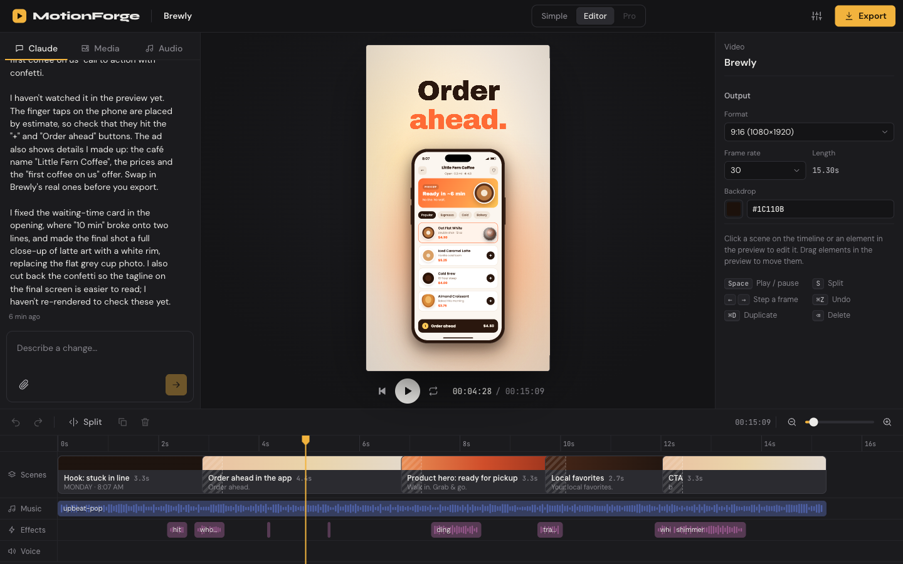
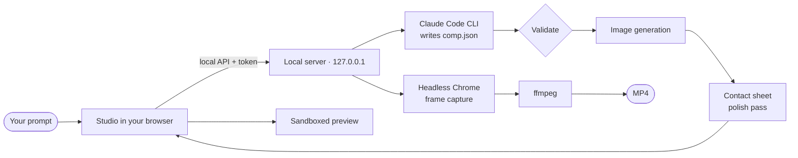

<div align="center">

# MotionForge

**Product ad videos from a single sentence, inside Claude Code.**

Describe your product or drop in a photo. MotionForge writes the story, generates the imagery, builds live app screens, scores it with music and sound effects, and hands you a timeline to finish it.

<!-- DEMO: replace this comment with the demo video made with /brag -->

<br>

[](LICENSE)
[](https://code.claude.com/docs/en/plugins)
[](https://nodejs.org)
[](#export)

</div>

<br>


<p align="center"><sub>Frames from three generated ads: <i>Penny</i> (banking app), <i>Brewly</i> (coffee ordering app) and <i>Lumen</i> (skincare serum). Every brand here is invented.</sub></p>

## Quick start

```bash
claude plugin marketplace add younann/motionforge
claude plugin install motionforge@motionforge-marketplace
```

Then type **`/motionforge:open`** in Claude Code. The studio opens in your browser.

Type what you want, for example *"A 15-second ad for Brewly, an app to order coffee ahead from local cafés"*, and press **Make it**. A few minutes later you have a finished ad on a timeline.

> Generation runs through **your own Claude Code CLI**. There's no API key to add and no backend to sign up for.

## What it makes

MotionForge doesn't stop at kinetic text over music. Every ad is built from real visual material:

| | |
|---|---|
| 📱 **Live app screens** | Real HTML/CSS interfaces inside iPhone, Android, tablet, browser and laptop frames, with taps, typing, counting numbers, state changes and scrolling, all in time with the video. |
| 🖼️ **Generated imagery** | Product shots, lifestyle scenes and backgrounds written as photography briefs and generated on the fly. Or use your own photos. |
| ✨ **Motion design** | 25 entrances, 15 exits, 10 loops, 15 transitions, camera moves, 3D tilt, and gradient, aurora and grain backgrounds. |
| 🎆 **Effects** | Confetti, sparkles, bokeh, light rays, speed lines, light leaks, glow orbs, shockwaves and more. |
| 🎵 **Sound** | 7 music tracks and 14 sound effects, original and CC0. Claude cuts the ad to the beat and places the sound effects on the cuts. |
| 🔍 **Polish pass** | Claude reviews a contact sheet of rendered frames and fixes cut-off text, collisions and weak shots before you see the result. |

## The studio



- **Simple mode**: one prompt box with format (9:16, 1:1, 4:5, 16:9), length and style. Attach an image and either feature it **in the scene** or **rebuild it as animation**.
- **Editor mode**: Claude chat, media and audio library on the left, live preview in the center, an inspector on the right, and a timeline with scene, music, effects and voice tracks.
  - Drag scenes to reorder them, trim or extend from the clip edges, split at the playhead, and use undo and redo.
  - Click any element in the preview to edit its text, font, colors, position and animation. Drag it to move it.
  - Select a scene and choose **Ask Claude** to rework only that scene.
- **Pro mode** (layers and keyframes) is next on the roadmap.

### Keyboard

| Key | Action | Key | Action |
|---|---|---|---|
| `Space` | Play / pause | `S` | Split at playhead |
| `←` `→` | Step one frame (`⇧` for 1 s) | `⌘D` | Duplicate scene |
| `⌘Z` / `⇧⌘Z` | Undo / redo | `⌫` | Delete selection |

## Export

720p, 1080p or 4K at 30 or 60 fps, as H.264 MP4 with mixed AAC audio. The preview and the export use the same frame-accurate renderer, so what you see is what you get. Files land in `~/.motionforge/projects/<id>/exports/`, and the dialog can download them or show them in Finder or Explorer.

## Requirements

| Needed for | What |
|---|---|
| Everything | [Node.js](https://nodejs.org) 20+ |
| Generating | [Claude Code](https://code.claude.com), installed and logged in |
| Exporting | [ffmpeg](https://ffmpeg.org) (with ffprobe) and Google Chrome or another Chromium browser |

Check your setup with `node scripts/doctor.mjs` from the plugin folder.

## Image generation

Choose the source in **Settings**, the sliders icon in the top bar.

| Source | Setup | Notes |
|---|---|---|
| **Pollinations** (default) | Nothing | Free. Without a token: one image every 45 s (queued automatically) and a small logo on images. A free token from [enter.pollinations.ai](https://enter.pollinations.ai) removes both. |
| **Hugging Face** | Token with Inference permission | FLUX.1 schnell, uses your free monthly credits |
| **Off** | | Claude uses only your photos, app screens, shapes and effects |

Image prompts are sent to the provider you choose. Generated images are cached per prompt, and you can edit a prompt and regenerate from the inspector.

## How it works



- **Composition**: Claude writes `comp.json`, made of scenes, layers (background, text, image, shape, ui, effect, cursor, code), animations, camera moves and audio clips. The format and the art-direction rules live in [`server/prompts/director.md`](server/prompts/director.md), with reference ads in [`server/prompts/examples/`](server/prompts/examples).
- **Renderer**: [`studio/engine/`](studio/engine) is deterministic. Every frame is a pure function of time, which makes scrubbing exact and exports frame-perfect.
- **Isolation**: generated screens and effect code run in a sandboxed iframe with a CSP that blocks all network access. The CLI runs with only Read/Write/Edit/Glob in the project folder, with no MCP servers, plugins or hooks.
- **No dependencies**: Chrome is driven through the DevTools protocol using Node's built-in WebSocket. The UI is Preact + htm, vendored, with no build step.

<details>
<summary><b>Environment variables</b></summary>

| Variable | Purpose |
|---|---|
| `MOTIONFORGE_PORT` | Port (default 4173) |
| `MOTIONFORGE_HOME` | Data folder (default `~/.motionforge`) |
| `MOTIONFORGE_CLAUDE_BIN` | Path to the `claude` binary |
| `MOTIONFORGE_MODEL` | Model passed to `claude --model` |
| `MOTIONFORGE_CHROME`, `MOTIONFORGE_FFMPEG`, `MOTIONFORGE_FFPROBE` | Binary overrides |

</details>

<details>
<summary><b>Security</b></summary>

The server listens on `127.0.0.1` only, requires a random bearer token from the launch link, checks the `Origin` header, and never runs a shell. Don't expose it through a proxy. Project data stays in `~/.motionforge/`.

</details>

## Roadmap

- [ ] Pro mode: layer and keyframe editor
- [ ] Background removal for uploaded product photos
- [ ] Windows and Linux testing
- [ ] Faster export

## Development

```bash
npm test                     # schema, timeline and edit tests
node scripts/doctor.mjs      # check requirements
node scripts/launch.mjs      # start or reuse the local server (--no-open to skip the browser)
node scripts/make-audio.mjs  # regenerate the bundled music and sound effects
```

Server logs: `~/.motionforge/server.log`. To try the plugin from a local folder: `claude --plugin-dir /path/to/motionforge`.

## License

[MIT](LICENSE) © younann. Bundled fonts are SIL Open Font License, the music and sound effects are CC0 (generated by `scripts/make-audio.mjs`), and the UI bundle is Preact (MIT) + htm (Apache 2.0). See the license notes in each folder.

Generation uses each user's own Claude Code setup and is subject to their plan's limits and Anthropic's terms. MotionForge doesn't provide or resell Claude access.
